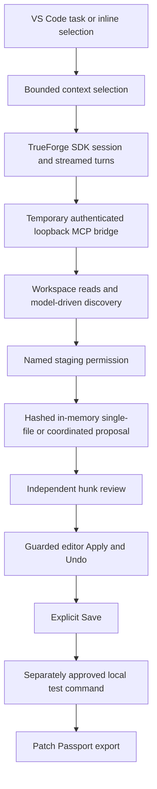

# SecureForge architecture

## Build flow

TrueForge supplies model routing, sessions, event streaming, tool dispatch and tool-approval pauses. SecureForge supplies repository policy, retrieval, proposal validation, editor review, local command confirmation and evidence. Model providers and their credentials are configured in TrueForge. SecureForge uses the official SDK and has no direct provider client.

## Context and proposal contracts

Automatic lexical retrieval ranks filenames and source matches, with test/documentation bonuses and explicit file/symbol attachments. It selects at most 12 excerpts under a default 24,000-byte source budget. Scans have independent file, byte and directory-entry budgets. Sources carry paths, reasons, line ranges and SHA-256 evidence.

The model can use `discover_repository` for bounded ranking and literal import relationships. `read_source_bundle` returns 1–4 complete existing files under 96 KiB aggregate UTF-8. It preserves exact source text, uses the hardened workspace reader, and returns nothing if any member is denied. Multi-file snapshots are not atomic.

Single-file proposals require the exact source hash. Coordinated proposals support complete-file batches and compact unique-text replacements. Compact requests expand through the same batch store and source policy. Proposals remain in process memory. Proposal staging never writes source files.

## Trust boundaries

| Boundary | Enforcement | Limitation |
| --- | --- | --- |
| Repository to model | Canonical relative paths, restricted-path policy, no symlink components, descriptor-based reads, UTF-8 and size checks, best-effort credential screening | Unexpected secret formats and malicious instructions require caution |
| Runtime to MCP | Loopback listener, temporary capability token, origin restrictions, advertised argument schemas and bounded tools | Minimal request/response MCP subset, no full interoperability claim |
| Runtime to staging approval | Resolve tool identity from streamed model events, display the name and counter, refuse repeated refs, cap eight requests | Permission stages a proposal and does not approve editor application |
| Proposal to editor | SHA-256 bases, clean-buffer/version checks, independent hunk decisions, one coordinated WorkspaceEdit | Apply changes buffers, Save remains separate |
| Closed file to Recheck | Policy/hash preflight before reopen, post-open verification, whole-group validation | Filesystem changes are not an atomic multi-file transaction |
| Test request to process | Allowlisted executable/argument shapes, exact-command approval, saved-buffer requirement, cancellation and timeout cleanup | Tests execute repository code with local-user authority |
| Events to exported evidence | Patch decisions, applied hashes, bounded redacted command output and linked owned-fixture proof | Evidence is an event record, not a signature or guarantee of later state |

Linux reads pin directory components through `/proc/self/fd`. macOS uses `O_NOFOLLOW_ANY`. Supported reads reject traversal, absolute paths, sensitive paths, symlinks, binaries and oversized input. Search screens whole-file credential content before slicing results.

Generated proposals may contain a small fixed set of harmless credential-test sentinels. The exemption applies only to complete literal values in newly proposed bytes. Original-source reads remain conservative. Screening remains best effort.

## Defend and Prove

Security Review is read-only and reports bounded pattern candidates with source hashes, evidence, impact, confidence and limitations. It does not prove exploitability for arbitrary repositories.

The owned traversal lab creates disposable vulnerable and safe controls. An approved baseline test must reproduce the expected failure. Its repair goes through regular hunk review, Apply and Save. A separately approved post-fix test must pass the same regression. Proof links receipt IDs, unchanged test hashes, before/after target hashes, the finding and approved proposal. Incomplete linkage produces an inconclusive result.

## Qualification

The handoff progress log and `outputs/live-model/handoff` distinguish real-model installed UI checks from deterministic runtime fixtures and source-level regressions. CI does not run paid models. Official acceptance and submission require their own evidence.
